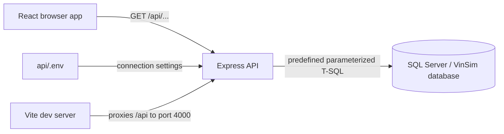
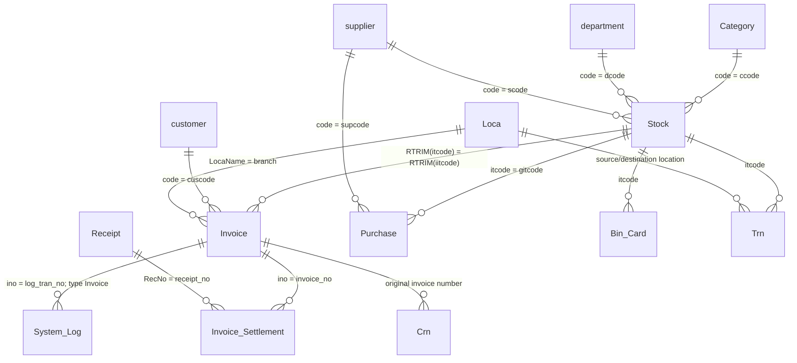

# Project and Database Structure

This document is the quick technical map for the Fitness Factory Analytics project.
It describes how the application is arranged, how data moves through it, and which
database structures the current code depends on. For the full database table inventory,
column notes, approximate row counts, and known data-quality issues, see the
[Database section of the README](README.md#database).

## 1. Project purpose

Fitness Factory Analytics is a read-only reporting dashboard for the VinSim point-of-sale
database used by Fitness Factory. It reports sales and product activity for the Havelock
City Mall (`HCM`) and One Galle Face (`One_Galle_Face`) shops.

The project has two applications:

- `api/` is a Node.js/Express API and is the only application allowed to connect to SQL Server.
- `web/` is a React/Vite single-page application. It only requests JSON from `/api`.

Database credentials and raw SQL must never be added to the frontend.

## 2. Runtime architecture



Development uses two processes:

- React/Vite: `http://localhost:5173`
- Express API: `http://localhost:4000`

In production, `npm run build` creates `web/dist`. If that directory exists, Express
serves the built frontend and API from the same origin.

## 3. Repository map

```text
FItness_Factory/
|-- package.json                  Root install/dev/build/start commands
|-- README.md                     Setup, API, complete DB inventory, and data gotchas
|-- PROJECT_DATABASE_STRUCTURE.md This quick architecture and data-model map
|-- api/
|   |-- .env.example              SQL Server and API configuration template
|   |-- package.json              Express, mssql, CORS, Helmet, rate limiting
|   `-- src/
|       |-- server.js             HTTP server, middleware, API mount, static web hosting
|       |-- db.js                 Shared SQL Server connection pool
|       |-- routes.js             API routes, validation, schema/table explorer
|       `-- metrics.js            Allow-listed dashboard metrics and their T-SQL
`-- web/
    |-- vite.config.js            Dev server and /api proxy
    `-- src/
        |-- main.jsx              React bootstrap
        |-- App.jsx               Hash-based page selection
        |-- api.js                Shared JSON fetch helper
        |-- pages/
        |   |-- registry.jsx      Navigation and page registry
        |   `-- DashboardPage.jsx Dashboard composition
        |-- components/
        |   |-- MetricWidget.jsx          Generic metric renderer
        |   |-- CategoryLeaders.jsx       Category best-seller analysis
        |   |-- CategoryProductsModal.jsx Category product detail
        |   |-- TodaySales.jsx            Daily sales analysis
        |   |-- SchemaExplorer.jsx        Database table browser
        |   `-- DataTable.jsx             Generic result table
        `-- layout/                       Admin shell, sidebar, and icons
```

## 4. Request and data flow

1. The page registry selects a React page from the URL hash.
2. A component calls `getJson()` from `web/src/api.js`.
3. Vite proxies `/api` to Express during development; production uses the same origin.
4. `api/src/routes.js` selects an allow-listed metric or catalog operation.
5. Query parameters are validated and bound with explicit SQL Server types.
6. `api/src/db.js` supplies the shared connection pool.
7. Express returns JSON; calculations intended for presentation are completed in React.

The browser never supplies SQL. Dashboard SQL is stored only in `api/src/metrics.js`.

## 5. API surface

| Endpoint | Source | Purpose |
|---|---|---|
| `GET /api/health` | `routes.js` | Verifies the SQL connection with `SELECT 1` |
| `GET /api/metrics` | `routes.js`, `metrics.js` | Lists visible metric metadata without exposing SQL |
| `GET /api/metrics/:id` | `routes.js`, `metrics.js` | Runs one allow-listed metric with validated parameters |
| `GET /api/schema` | `routes.js` | Returns visible tables/views and their columns |
| `GET /api/tables/:schema/:table/rows` | `routes.js` | Returns a stable, paginated view of a catalog-confirmed table |

Current metric IDs are:

- Visible: `table-count`, `total-rows`, `best-sellers-by-category`, `rows-per-table`.
- Helper metrics: `invoice-years`, `category-products`, `daily-sales-lines`.

Allowed metric parameters are `from`, `to`, `year`, `month`, `rankBy`, `top`,
`category`, `date`, and `shop`. Their validation and SQL types are defined in the
`PARAMS` object in `api/src/routes.js`.

## 6. Database overview

- Engine: Microsoft SQL Server 2022.
- Compatibility level: 100 (SQL Server 2008 SQL feature set).
- Application schema: `dbo`.
- Access model: a read-only `db_datareader` login.
- Physical foreign keys: none; relationships below are logical application relationships.
- Primary keys: absent from many legacy tables.

The current dashboard directly queries only these business tables:

| Table | Role in this application |
|---|---|
| `dbo.Invoice` | Sales fact table; one row per invoice line |
| `dbo.Stock` | Product/item master and current product attributes |
| `dbo.System_Log` | POS audit events; authoritative 24-hour invoice timestamp |

It also queries SQL Server catalog views (`INFORMATION_SCHEMA.TABLES`,
`INFORMATION_SCHEMA.COLUMNS`, `INFORMATION_SCHEMA.TABLE_CONSTRAINTS`,
`INFORMATION_SCHEMA.KEY_COLUMN_USAGE`, `sys.tables`, `sys.schemas`, and
`sys.partitions`) to power database summary cards and the table explorer.

## 7. Logical database model



### Core table grain and keys

| Table | Grain | Important identifiers |
|---|---|---|
| `Invoice` | One sold item line | `row_ID` is the row PK; `ino` groups lines into an invoice; `iitcode` identifies the product |
| `Stock` | One product | `itcode` is the product key; `ccode`/`cdes` identify its category |
| `System_Log` | One POS audit event | `log_tran_no` identifies the related document; filter `log_tran_type = 'Invoice'` for sales |
| `Purchase` | One GRN item line | `gno` groups receipt lines; `gitcode` identifies the product |
| `Bin_Card` | One stock movement | `itcode`, `loca`, `tdate`, `tran_type`, and `ref_no` describe the movement |
| `Trn` | One transfer item line | Product plus `trnfromloc` and `trntoloc` |

## 8. Sales calculation rules

These rules are required for correct reporting:

- Calculate line revenue as `iquan * icost - ISNULL(itemdiscount, 0)`.
- Do not sum `Invoice.iamount`, `Subtotal`, or `grandtot`; invoice totals are repeated on every line.
- Group by `ino` when counting invoices.
- Join product data with `RTRIM(Stock.itcode) = RTRIM(Invoice.iitcode)` because legacy codes are padded.
- Prefer `Stock.cdes` for the current category and fall back to `Invoice.item_category_des`.
- Use `Invoice.costprice` for cost at the time of sale; zero cost is treated as unknown.
- Use the earliest matching `System_Log.log_dateTime` for invoice time. `Invoice.sale_DateTime` loses AM/PM.
- Resolve "today" in Sri Lanka (`UTC+05:30`), not with the database server's local date.
- Cancelled invoices are moved to `Canceled_Invoice`; returns in `Crn` are not currently subtracted.
- SQL Server `bigint` and `decimal` values may reach JavaScript as strings and need explicit conversion.

## 9. Database areas

The wider VinSim database contains these functional groups:

- Sales: `Invoice`, `Canceled_Invoice`, `Receipt`, `Invoice_Settlement`, `Crn`, and related order/tax tables.
- Inventory: `Stock`, `Category`, `department`, `Loca`, `Bin_Card`, `Trn`, `Physical`, and serial-number tables.
- Purchasing: `Purchase`, `Canceled_Purchase`, `GRN_Tax`, `supplier`, and supplier settlement/order tables.
- Finance: `Bank`, `Payee`, `Tax`, cash-book, cheque, and account-reconciliation tables.
- Customers: `customer` and debtor statement data.
- System/configuration: `System_Log`, `Branch_Settings`, application settings, counters, users, and temporary report tables.

See [Tables by area](README.md#tables-by-area) for the individual table inventory and
[Key tables in detail](README.md#key-tables-in-detail) for column-level descriptions.

## 10. Security boundaries

- `api/.env` is git-ignored and is the only location for database credentials.
- The intended SQL login is read-only.
- `dbo.users` and `dbo.UserPermissions` are explicitly blocked from both explorer endpoints.
- Binary, spatial, timestamp, and hierarchy columns are excluded from explorer row responses.
- User values never become SQL identifiers or SQL text in metric queries.
- Explorer identifiers must first exist in SQL Server catalog results and are bracket-quoted.
- The API applies Helmet headers, an origin allow-list, and a 120-request-per-minute rate limit.
- The dashboard currently has no application login, so it must not be publicly exposed.

## 11. Where to make common changes

| Change | File(s) |
|---|---|
| Add or change a dashboard query | `api/src/metrics.js` |
| Add a supported query parameter | `api/src/routes.js` (`PARAMS`) |
| Add a page or navigation item | `web/src/pages/registry.jsx` plus the new component |
| Change database connection behavior | `api/src/db.js` and `api/.env.example` |
| Add a shop | API `SHOPS` in `routes.js` and UI `SHOPS` in `TodaySales.jsx` |
| Block another sensitive table | `BLOCKED_TABLES` in `api/src/routes.js` |
| Change theme/layout | `web/src/styles.css` and `web/src/layout/` |
| Update verified DB documentation | `README.md` and this file if architecture or core relationships changed |

## 12. Known limitations

- Returns are not subtracted from sales metrics.
- Product location quantity columns in `Stock` are inferred and need business confirmation.
- Explorer paging can be expensive for large tables without primary keys.
- The schema explorer is read-only but can reveal all non-blocked business tables.
- Database row counts in the README are snapshots, not live guarantees.

