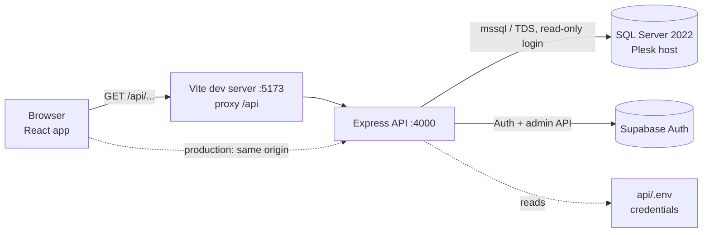
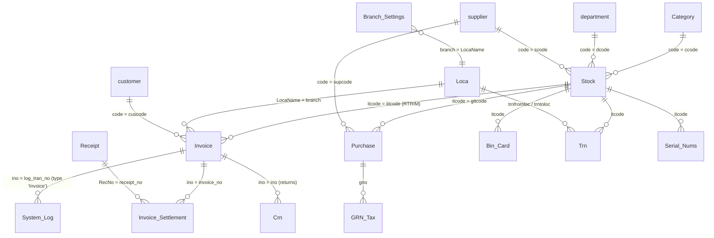

# Fitness Factory Analytics

A read-only analytics dashboard for the Fitness Factory point-of-sale (POS) database.
The Fitness Factory sells supplements and gym accessories from two shops: **Havelock City Mall** and **One Galle Face**.

For a concise technical onboarding map, see
[`PROJECT_DATABASE_STRUCTURE.md`](PROJECT_DATABASE_STRUCTURE.md).

- **`api/`**: Node.js + Express. It is the only part that talks to SQL Server and holds the database credentials.
- **`web/`**: React (Vite) single-page app. It calls `/api/...` only and never sees credentials or SQL.

> **Contents:** [Quick start](#quick-start) · [Architecture](#architecture) · [Project structure](#project-structure) · [API](#api) · [Adding a metric](#adding-a-new-metric) · [Frontend](#frontend) · [Database](#database) · [Data gotchas](#data-gotchas-read-before-writing-queries) · [Security](#security) · [Known issues](#known-issues--todo)

---

## Quick start

**Requirements:** Node.js 20.6+ (developed on 22), and network access to the SQL Server.

```powershell
# 1. Install dependencies (root, api, web)
npm run install:all

# 2. Configure the database connection (server-side only)
copy api\.env.example api\.env
#    then edit api\.env. Ask the project owner for the credentials.

# 3. Run API (http://localhost:4000) and web (http://localhost:5173) together
npm run dev
```

Check the connection: <http://localhost:4000/api/health> should return `{"ok":true}`.

| Script (run from the project root) | What it does |
|---|---|
| `npm run install:all` | Installs dependencies for root, `api` and `web` |
| `npm run dev` | Runs the API (auto-restarts on change) and the Vite dev server together |
| `npm run build` | Builds the React app into `web/dist` |
| `npm start` | Runs the API only. If `web/dist` exists, the API also serves the built app, so everything runs from one address |

### Environment variables (`api/.env`)

| Variable | Example | Notes |
|---|---|---|
| `DB_SERVER` | `p1409.use1.mysecurecloudhost.com` | Plesk-hosted SQL Server 2022 |
| `DB_PORT` | `1433` | Ignored when `DB_INSTANCE` is set |
| `DB_INSTANCE` | *(empty)* | Named instance, e.g. `MSSQLSERVER2022`, if connecting by port fails |
| `DB_NAME` | `rgtlslco_VinSim_Fitness_Factory_New` | |
| `DB_USER` / `DB_PASSWORD` | `rgtlslco_tmp_ff` / *(secret)* | A **read-only** (`db_datareader`) login |
| `DB_ENCRYPT` | `true` | |
| `DB_TRUST_CERT` | `true` | The server uses a self-signed certificate |
| `PORT` | `4000` | API port |
| `CORS_ORIGIN` | `http://localhost:5173` | Comma-separated list of allowed browser origins |
| `SUPABASE_URL` | `https://project-ref.supabase.co` | Supabase project API URL |
| `SUPABASE_PUBLISHABLE_KEY` | `sb_publishable_...` | Used server-side for sign-in and session validation |
| `SUPABASE_SECRET_KEY` | `sb_secret_...` | Server-only; required for user invitations and administration |
| `SUPABASE_SUPER_ADMIN_EMAILS` | `owner@example.com` | Verified accounts allowed to manage users; comma-separated |
| `APP_ORIGIN` | `http://localhost:5173` | Allowed redirect target for invitations and password recovery |
| `NODE_ENV` | `production` | Optional. Hides internal error messages from API responses |

`api/.env` is git-ignored. **Never commit it, and never put credentials in `web/`.**

---

## Architecture



The main design rule: **the browser never sends SQL.** Every query lives on the server in
[`api/src/metrics.js`](api/src/metrics.js). The frontend asks for a metric by `id` and passes only
validated parameters (year, date, shop, …), which are bound as typed SQL parameters.

---

## Project structure

```
FItness_Factory/
├── package.json              # root scripts: install:all, dev, build, start (uses concurrently)
├── .gitignore                # node_modules, dist, .env
├── README.md
│
├── api/                      # Backend: the only component with DB access
│   ├── .env.example          # template for api/.env
│   ├── package.json          # express 5, mssql, helmet, cors, express-rate-limit
│   └── src/
│       ├── server.js         # Express app: security headers, CORS, rate limit, /api routes,
│       │                     #   serves web/dist in production, error handler
│       ├── db.js             # SQL Server connection pool (reads env vars, retries after failure)
│       ├── routes.js         # HTTP endpoints + parameter validation (PARAMS) + table explorer
│       └── metrics.js        # Registry of every SQL query the dashboard can run
│
└── web/                      # Frontend: React 18 + Vite + Recharts
    ├── index.html
    ├── vite.config.js        # dev proxy: /api → http://localhost:4000
    ├── package.json
    └── src/
        ├── main.jsx          # React entry point
        ├── App.jsx           # top navigation + page switching (URL hash: #dashboard, #today, #explorer)
        ├── api.js            # getJson(path): fetch wrapper for /api
        ├── styles.css        # all styles; theme colours are CSS variables at the top
        └── components/
            ├── MetricWidget.jsx          # generic card: KPI number, bar/line chart, or table
            ├── CategoryLeaders.jsx       # "Best-selling items by category" card (year/month/rank/top filters)
            ├── CategoryProductsModal.jsx # pop-up: every product in a category for a year/month, sortable columns
            ├── TodaySales.jsx            # "Today's sales" page (shop + date filters, auto-refresh)
            ├── SchemaExplorer.jsx        # "Data explorer" page: browse any table with paging
            └── DataTable.jsx             # generic table: resizable columns, date/number formatting
```

---

## API

Base path: `/api`. Business-data endpoints require a valid Supabase session. Errors look like `{ "error": "message" }`.
Requests are limited to 120 per minute per IP.

| Endpoint | Purpose |
|---|---|
| `/health` | Runs `SELECT 1` → `{ ok: true }` |
| `/auth/login`, `/auth/logout`, `/auth/session` | HttpOnly-cookie authentication lifecycle |
| `/admin/users` | Super-admin-only user listing and management |
| `/metrics` | Lists the metrics shown on the dashboard (without SQL; hidden metrics are left out) |
| `/metrics/:id?…params` | Runs a metric → `{ rows: [...] }` |
| `/schema` | Tables and columns, used by the Data explorer (blocked tables left out) |
| `/tables/:schema/:table/rows?page=1&pageSize=100` | Paged rows of a table → `{ rows, total, page, pageSize, hiddenColumns }`. `pageSize` is at most 1000. Binary columns (e.g. `Stock.pics`) are left out |

### Metrics registry ([`api/src/metrics.js`](api/src/metrics.js))

| id | Shown as | Params | Returns |
|---|---|---|---|
| `table-count` | KPI card | none | number of tables |
| `total-rows` | KPI card | none | total rows in all tables |
| `best-sellers-by-category` | `CategoryLeaders` card | `year`, `month`, `rankBy`, `top` | top N items per category with category totals |
| `rows-per-table` | horizontal bar chart | none | 15 largest tables |
| `invoice-years` | *hidden* (fills the year dropdown) | none | years that have invoices |
| `category-products` | *hidden* (used by the category pop-up) | `year`, `month`, `category` | every product in a category: qty, revenue, invoices, last sold, cost per unit |
| `daily-sales-lines` | *hidden* (used by the Today's sales page) | `date`, `shop` | every invoice line for one day, with the corrected sale time |

### Query parameters (`PARAMS` in [`api/src/routes.js`](api/src/routes.js))

A metric may only accept parameters listed in its `params` array. Each one is validated and bound as a typed SQL input.

| Param | Accepted values | Default | Bound as |
|---|---|---|---|
| `from`, `to` | `YYYY-MM-DD` | `NULL` | `@from`, `@to` (date) |
| `year` | 2000–2100 | current year | `@yearStart`, `@yearEnd` (exclusive), both dates |
| `month` | 0–12 (0 = whole year) | `0` | `@month` (int) |
| `rankBy` | `qty` \| `revenue` | `qty` | `@rankBy` |
| `top` | 1–10 | `1` | `@top` (int) |
| `category` | category name, up to 100 characters | *(required)* | `@category` (nvarchar) |
| `date` | `YYYY-MM-DD` | `NULL` = today in Sri Lanka (worked out in SQL) | `@date` (date) |
| `shop` | `all` \| `HCM` \| `One_Galle_Face` | `all` | `@shop` |

---

## Adding a new metric

1. **Add an entry** to the `metrics` array in [`api/src/metrics.js`](api/src/metrics.js):

   ```js
   {
     id: 'revenue-by-month',
     title: 'Revenue by month',
     type: 'bar',          // 'kpi' | 'bar' | 'line' | 'table' (or a custom type handled in App.jsx)
     x: 'month',           // column for the X axis / category labels
     y: 'revenue',         // column (or array of columns) for values
     yLabel: 'Revenue',    // optional tooltip label
     layout: 'horizontal', // optional, for bar charts with long labels
     wide: true,           // optional, full-width card
     params: ['year'],     // optional, must exist in PARAMS
     hidden: false,        // true = not shown as a card (helper query for a custom component)
     sql: `
       SELECT MONTH(idate) AS month,
              SUM(iquan * icost - ISNULL(itemdiscount, 0)) AS revenue
       FROM dbo.Invoice
       WHERE idate >= @yearStart AND idate < @yearEnd
       GROUP BY MONTH(idate)
       ORDER BY month`,
   },
   ```

2. **If you need a new parameter,** add a validator to `PARAMS` in [`api/src/routes.js`](api/src/routes.js). It should bind typed inputs with `request.input(...)`, and return an error message string if the value is invalid.

3. **Display it.** `kpi`, `bar`, `line` and `table` cards appear on the dashboard automatically through `MetricWidget`. For anything custom, create a component and render it for your `type` in [`web/src/App.jsx`](web/src/App.jsx), as `category-leaders` does.

4. **Rules:**
   - **Never** build SQL from request values.
   - Read the [data gotchas](#data-gotchas-read-before-writing-queries) first. Most wrong numbers come from them.

---

## Frontend

The app is an admin shell: a fixed left menu (`web/src/layout/Sidebar.jsx`) beside a
content column with a sticky title bar (`web/src/layout/AdminLayout.jsx`). The menu is
collapsible to an icon rail (the choice is remembered in `localStorage`) and turns into a
drawer below 860px. The open page lives in the URL hash, so `#today` can be bookmarked.

| Page (URL hash) | Component | What it shows |
|---|---|---|
| Dashboard (`#dashboard`) | `pages/DashboardPage.jsx` → `MetricWidget`, `CategoryLeaders` | KPI cards, best sellers per category with year, month, rank-by and top-N filters (click a tile → `CategoryProductsModal`, which opens on the same year and month), largest tables chart |
| Sales → Today's sales (`#today`) | `TodaySales.jsx` | Shop filter (All / Havelock City Mall / One Galle Face), date picker (defaults to today in Sri Lanka), KPIs (revenue, invoices, items, profit), shop split, sales by hour, invoice list, top items. Today's view refreshes every 60 seconds |
| Products → Items & prices (`#items`) | `pages/ItemPricesPage.jsx` → `ItemTable.jsx` | Every item in `dbo.Stock` with cost, retail and wholesale price, margin and total stock. Search, category filter and column sorting |
| Products → Stock by location (`#stock`) | `pages/StockByLocationPage.jsx` → `ItemTable.jsx` | Quantity per location with totals and a location filter (summary tiles also show stock value at cost). The locations come from the database, so only those actually holding stock are shown |
| Data explorer (`#explorer`) | `SchemaExplorer.jsx` → `DataTable.jsx` | Browse any (non-blocked) table, 100–1000 rows per page |

### Adding a page

Every menu entry and page lives in one file: [`web/src/pages/registry.jsx`](web/src/pages/registry.jsx).

1. Write the component, e.g. `web/src/pages/StockPage.jsx`.
2. Add one entry to `MENU`:

```jsx
{ id: 'stock', label: 'Stock', icon: 'box', title: 'Stock on hand',
  subtitle: 'Current quantities per shop', element: <StockPage /> }
```

`id` is the URL hash (`#stock`). `title` and `subtitle` fill the top bar, so the page
component itself does not need a heading. Nest sub-pages under `children` and the parent
opens its first child, exactly like the WordPress admin menu:

```jsx
{ id: 'sales', label: 'Sales', icon: 'sales', children: [ /* pages */ ] }
```

Icons are the keys of `PATHS` in [`web/src/layout/Icon.jsx`](web/src/layout/Icon.jsx)
(`dashboard`, `sales`, `database`, `box`, `users`, `settings`, `page`); an unknown name
falls back to a generic page icon. Add new ones by pasting the inner markup of a 24×24
stroked SVG.

**Conventions**
- **Data fetching:** all fetches go through `getJson()` in [`web/src/api.js`](web/src/api.js) and use relative `/api/...` URLs only.
- **Money:** formatted as LKR with `Intl.NumberFormat('en-LK', { currency: 'LKR' })`.
- **Theme:** always dark (near-black background, white text, blue accent). Change the colours through the CSS variables at the top of [`web/src/styles.css`](web/src/styles.css): `--bg`, `--card`, `--text`, `--muted`, `--border`, `--accent`, `--accent-strong`, `--accent-button`, `--accent-soft`, `--on-accent`. Chart series colours are in `COLORS` in `MetricWidget.jsx`, and the shop colours are in `SHOP_COLORS` in `TodaySales.jsx`.
- **Prices:** `Stock.cprice` is the current unit cost and `Stock.uprice` the retail price; both were verified against `Invoice.costprice` / `Invoice.icost` on real sales lines. `mprice` (minimum) and `relevel` (re-order level) are `0` on every item, so no page shows them.
- **Stock quantities:** `dbo.Stock` has one quantity column per location, named after the rows of `dbo.Loca`. The `stock-by-location` metric reads that list from `dbo.Loca`, matches it against `sys.columns` and unpivots with dynamic SQL, so **no location is hard-coded anywhere** — add a location in the POS and it appears on its own. It returns one row per item per location; the page folds that into a row per item and shows only the locations actually holding stock. Friendly names live in [`web/src/locations.js`](web/src/locations.js), which falls back to the location code, so an unknown location still displays. These balances reconcile with the `Bin_Card` ledger; note `Bin_Card` also contains pre-2023 rows from an unrelated business, so do not total it blindly.
- **Shop names:** the code-to-name mapping (`HCM` → "Havelock City Mall") is in `SHOPS` in `TodaySales.jsx`. The allowed codes are also listed in `SHOPS` in `routes.js`, so update both when a shop is added.

---

## Database

| | |
|---|---|
| **Engine** | Microsoft SQL Server 2022, hosted on Plesk |
| **Database** | `rgtlslco_VinSim_Fitness_Factory_New` |
| **Compatibility level** | **100 (SQL Server 2008)** |
| **Schema** | Everything is in `dbo`. The schemas `mnmfaizal`, `rgtlslco_tmp_ff` and `vinsim_fitness_factory_New` exist but are empty |
| **Dashboard login** | `rgtlslco_tmp_ff`, member of `db_datareader` (read-only) |
| **Source system** | A desktop POS application ("VinSim") running on shop PCs. This dashboard only reads from it |

**Compatibility level 100 limits which SQL you can use.**
- **Unavailable:** `STRING_AGG`, `STRING_SPLIT`, `OPENJSON`, `TRIM`, `IIF`, `CONCAT_WS`, and similar newer functions. Use `RTRIM(LTRIM())`, `CASE`, and aggregate in JavaScript where needed.
- **Available:** window functions (`ROW_NUMBER`, `SUM() OVER`), CTEs and `SWITCHOFFSET`.

**There are no foreign keys.** The relationships below are *logical*: they come from column names and have been checked against the data where noted. Most tables have no primary key either.

> Row counts are approximate, as of September 2026. Table purposes marked *(inferred)* come from names and columns and haven't been confirmed against the POS application.

### Relationship diagram (main sales & inventory tables)



### Tables by area

#### Sales

| Table | Rows | Purpose |
|---|---:|---|
| **`Invoice`** | 8,427 | **Main sales table. One row per invoice *line*** (see below) |
| `Canceled_Invoice` | 74 | Cancelled invoice lines: same columns as `Invoice`, plus `Canceled_Date/user/workstation/branch`. Cancelled sales are *moved* here, so `Invoice` contains no cancelled sales |
| `Invoice_Settlement` | 413 | Links receipts to credit invoices (`receipt_no`, `invoice_no`, `amount`, `canceled`) |
| `Receipt` | 100 | Customer payments received (`RecNo`, `RecDate`, `Amount`, `Method`, `invoice_no`, `balance_due`) |
| `Canceled_Receipt` | 0 | Cancelled receipts |
| `Crn` | 3 | Credit notes / sales returns (`cno`, `ino` = original invoice, `citcode`, `cquan`, `camount`) |
| `Debtor_Statement` | 131 | Customer account statement lines *(inferred)* |
| `Invoice_Tax` | 0 | Tax lines per invoice |
| `Quotations`, `Sales_Order` | 0 | Not used |
| `Rewards_log` | 0 | Loyalty reward postings *(inferred)* |
| `OGF_Log` | 1,954 | Import/batch log for the One Galle Face mall integration (`batchCode`, `returnStatus`, `recordsImported`) *(inferred)* |
| `Job_Note`, `JobNote_Items`, `JobNote_accessories`, `Jobnote_Customers`, `Service` | 0 | Repair/service job cards. Not used |

#### Inventory

| Table | Rows | Purpose |
|---|---:|---|
| **`Stock`** | 96 | **Item master**, one row per product (see below) |
| `Category` | 7 | Item categories (`code`, `des`): PRT Protien, CRT Creatine, ACC Accessories, PWO Prework outs, FTB Fat burners, RCV Recovery, JMV Joint support and multivitamin |
| `department` | 2 | Item departments (`code`, `des`) |
| `Loca` | 4 | Locations: `HCM`, `One_Galle_Face`, `Hill_Street`, `Gym_Store`. Only `HCM` and `One_Galle_Face` record sales |
| `Bin_Card` | 21,358 | Stock movement ledger (`tdate`, `tran_type`, `loca`, `itcode`, `Qty`, `ref_no`) |
| `Trn` | 1,198 | Stock transfers between locations (`trnfromloc`, `trntoloc`, `itcode`, `qty`) |
| `Physical` | 191 | Physical stock counts (`pitcode`, `currentqty`, `pqty`, `loca`) |
| `Serial_Nums` | 1,335 | Serial-numbered units in/out *(inferred)* |
| `Serial_Num_Log` | 14,847 | Serial number movement log |
| `Stock_Reorder` | 0 | Auto-reorder suggestions |
| `Warranty_Item_Ledger` | 0 | Warranty claims. Not used |

#### Purchasing & suppliers

| Table | Rows | Purpose |
|---|---:|---|
| `Purchase` | 929 | Goods received notes (GRN), one row per line (`gno`, `gdate`, `gitcode`, `gqty`, `gcost`, `gamount`, `supcode`, `loca`) |
| `GRN_Tax` | 16 | Tax lines per GRN |
| `Canceled_Purchase` | 9 | Cancelled GRN lines |
| `supplier` | 1 | Suppliers (`code`, `des`, contact details, balances) |
| `Srn` | 0 | Supplier returns |
| `Purchase_Order`, `Purchase_Settlement`, `Payment`, `Canceled_Payment` | 0 | Not used |
| `Creditor_Statement` | 1 | Supplier account statement lines *(inferred)* |

#### Finance

| Table | Rows | Purpose |
|---|---:|---|
| `Bank` | 19 | Bank accounts (`code`, `name`, `accno`, `bfbalance`) |
| `Payee` | 66 | Payees for cash book / petty cash |
| `Tax` | 2 | Tax rates (`TaxName`, `Per`) |
| `CashBook`, `PettyCash`, `ChequePrint`, `ChequesInHand`, `ReturnCheques`, `AccountsRec`, `RecCalculatedBal` | 0 | Not used |

#### Customers

| Table | Rows | Purpose |
|---|---:|---|
| `customer` | 7 | Customer accounts (`code`, `des`, phones, `credit`, `MaxCr`, `Branch`). Walk-in sales use generic customers such as "Cash Customer - OGF" |

#### System & configuration

| Table | Rows | Purpose |
|---|---:|---|
| **`System_Log`** | 11,979 | Audit log of POS actions (`log_dateTime`, `log_tran_type`, `log_tran_no`, `log_branch`, `log_user`, `log_amount`). **The reliable source of invoice times** (see gotchas) |
| `SMS` | 3,111 | SMS messages sent to customers (`sms_date`, `mobile_no`, `message`, `sent`) |
| `Branch_Settings` | 10 | Maps each POS computer (`local_name`) to a branch |
| `users` | 8 | ⚠️ **POS user accounts, with passwords in plain text.** Blocked from the API |
| `UserPermissions` | 77 | ⚠️ Per-user permission matrix (one bit column per user name). Blocked from the API |
| `Company`, `Global_Settings`, `S_Settings`, `sms_settings` | 1–31 | Application settings |
| `Running_No`, `Transaction_ID` | 1–6 | Document number counters per workstation |
| `dtproperties` | 0 | Legacy SQL Server diagram table |
| `Tmp_*` (`Tmp_GP`, `Tmp_Dep_Wise_Sales_Summary`, `Tmp_Itemwise_Sales`, `Tmp_BarCode`, `Tmp_CashBook`) | 0–1,510 | **Scratch tables the POS fills while printing reports** (keyed by `computer`). Never use them for analytics |

### Key tables in detail

#### `dbo.Invoice`: one row per invoice line

| Column | Type | Meaning |
|---|---|---|
| `row_ID` | bigint identity | Primary key |
| `seq` | uniqueidentifier | Row GUID |
| `ino` | varchar(40) | **Invoice number**, shared by all lines of one invoice. The prefix identifies the workstation (e.g. `7-6509`, `10013-3393`) |
| `idate` | datetime | **Invoice date** (time part is always 00:00) |
| `sale_DateTime` | datetime | ⚠️ Sale time **in 12-hour form without AM/PM**. Use `System_Log` instead |
| `branch` | varchar(25) | **Shop code:** `HCM` (Havelock City Mall) or `One_Galle_Face` |
| `staff` | varchar(30) | Cashier / salesperson |
| `computername` | varchar(35) | POS PC |
| `iitcode` / `iitdes` | varchar | Item code / description as printed. ⚠️ Padded with trailing spaces |
| `item_category_code` / `item_category_des` | varchar | Category *at the time of sale* (sometimes NULL or out of date) |
| `iquan` | float | **Quantity** |
| `icost` | float | **Unit selling price** (despite the name) |
| `costprice` | float | **Unit cost** at the time of sale |
| `itemdiscount` | float | Discount on this line |
| `iamount` | float | ⚠️ **Whole-invoice total repeated on every line**, not the line amount |
| `Subtotal`, `Discount`, `TotalTax`, `grandtot` | float | ⚠️ Invoice-level totals, repeated on every line |
| `settled_amount`, `refund`, `returend`, `sales_advance` | float | Settlement / return tracking |
| `cuscode` / `cusdes` / `address` / `Cus_phone_no` | varchar | Customer |
| `methoed` | varchar(20) | Payment method: `Cash` or `Credit` (padded) |
| `CC_*` | | Card payment details |
| `Invoice_type`, `saletype`, `warrantytype`, `showtype` | | Always `Inventory` / 0 in current data |
| `ogf_*` | | One Galle Face mall rewards integration fields |
| `hcm_*`, `Is_hcm_Smiles_points` | | Havelock City Mall loyalty ("Smiles") integration fields |

**Indexes:** `row_ID` (clustered primary key), `idate`, `methoed`, `cuscode`. Filter on `idate` with a range (`>= @start AND < @end`) so the index is used.

#### `dbo.Stock`: item master

| Column | Meaning |
|---|---|
| `itcode` | Item code (primary key) |
| `itname`, `short_des`, `long_des` | Names |
| `ccode` / `cdes` | Category code / name (**use this for categories**) |
| `dcode` / `ddes` | Department |
| `scode` / `sdes` | Supplier |
| `cprice` | Current unit cost |
| `uprice`, `wprice`, `mprice` | Retail / wholesale / minimum price *(inferred)* |
| `relevel` | Re-order level |
| `One_Galle_Face`, `HCM`, `Hill_Street`, `Gym_Store`, `dummy_loca` | Per-location stock quantity *(inferred from column names; check before use)* |
| `pics` | `image` column (product photo). Excluded from the explorer |
| `warranty_*`, `upload_to_web`, `is_active_autoreorder`, `zeero_stock_date` | Misc flags |

#### `dbo.System_Log`: audit log

| Column | Meaning |
|---|---|
| `log_dateTime` | **Correct 24-hour timestamp** (Sri Lanka local time) |
| `log_tran_date` | Business date of the transaction |
| `log_tran_type` | `Invoice`, `TRN`, `Purchase`, `Receipt`, `CRN`, `Cancel Transaction-Invoice`, `User Permission`, … |
| `log_tran_no` | Document number (for invoices = `Invoice.ino`) |
| `log_branch`, `log_user`, `log_amount`, `log_memo` | Context |

An invoice can have more than one log row. Use `MIN(log_dateTime)` per `log_tran_no`.

---

## Data gotchas (read before writing queries)

These were found by checking the live data. Each one produces wrong numbers if you ignore it.

1. **Don't add up `Invoice.iamount`, `Subtotal` or `grandtot`.** They hold the *whole invoice* total on every line, so summing them counts multi-line invoices several times.
   - **Line revenue** = `iquan * icost - ISNULL(itemdiscount, 0)`. This matches `grandtot` for 6,704 of 6,708 invoices.
   - **Invoice total:** group by `ino`, or take `MAX(grandtot)` per `ino`.

2. **`Invoice.sale_DateTime` has no AM/PM.** Hours only range from 1 to 12, so 5:11 PM is stored as `05:11`.
   - For the real time, join `System_Log` on `RTRIM(log_tran_no) = RTRIM(ino)` with `log_tran_type = 'Invoice'`.
   - The `daily-sales-lines` metric does this. It falls back to "hours 1–9 are PM", since the shops trade from about 10:00 to 22:00.

3. **Time zones.** The DB server clock is in a **US timezone**, but the shops and all stored timestamps use **Sri Lanka time (UTC+05:30)**.
   - Don't use `GETDATE()` for "today". Use `CAST(SWITCHOFFSET(SYSDATETIMEOFFSET(), '+05:30') AS date)`.
   - In the browser, use `Intl.DateTimeFormat('en-CA', { timeZone: 'Asia/Colombo' })`.
   - The `mssql` driver labels `datetime` values with `Z` (UTC). They are really local time, so format them as strings. Don't convert them through `new Date()` and a timezone.

4. **Codes and names are padded with spaces** (`'ACC003                   '`, `'Cash                '`). Always `RTRIM` them, especially in joins: `RTRIM(s.itcode) = RTRIM(i.iitcode)`.

5. **Categories:** use `Stock.cdes` (joined on the item code) and fall back to `Invoice.item_category_des`. The invoice copy is sometimes NULL or out of date. The category name is spelled **"Protien"** in the data. Match it exactly.

6. **Cost:** `Invoice.costprice` is the unit cost at the time of sale. A few lines have `0`; exclude them when averaging. The daily-sales query returns `cost` as NULL for those lines and the Today’s sales profit KPI leaves them out of both revenue and cost, so they are not counted as pure margin. Costs change during the year, so use a quantity-weighted average. `Stock.cprice` is only the *current* cost.

7. **Returns and cancellations:** cancelled invoices are *moved* to `Canceled_Invoice` and are not in `Invoice`. Returns (`Crn`) are rare (3 rows) and aren't currently subtracted.

8. **Big numbers arrive as strings.** `bigint` and `decimal` results come back from `mssql` as strings. `CAST(... AS int)` in SQL, or convert with `Number()` in JavaScript. `MetricWidget` does this for chart values.

9. **Shop codes:** `Invoice.branch` holds `HCM` or `One_Galle_Face`, not display names. Map them in the UI.

---

## Security

- **Credentials:** they live only in `api/.env` on the server. The frontend has no secrets.
- **Authentication:** Supabase access and refresh tokens stay in `HttpOnly`, `SameSite=Strict` cookies and are never stored by React.
- **User administration:** the Supabase secret key is server-only. Each admin request first validates the current session and then requires the `super_admin` role.
- **No SQL from the browser:** only predefined queries (`metrics.js`) with validated, typed parameters run. Table and column names in the explorer come from the system catalog, never from user input, and are bracket-quoted.
- **Read-only login:** the database login is `db_datareader`, so it can't change data even if the API were compromised.
- **Blocked tables:** `dbo.users` (plain-text passwords) and `dbo.UserPermissions` are hidden from `/schema` and `/tables`. Add any other sensitive tables to `BLOCKED_TABLES` in `routes.js`.
- **Hidden columns:** binary columns (`image`, `varbinary`, …) are never sent to the browser.
- **Hardening:** `helmet` security headers, CORS restricted to `CORS_ORIGIN`, rate limit of 120 requests per minute, and generic error messages when `NODE_ENV=production`.

---

## Known issues / TODO

- **Returns not subtracted:** `Crn` credit notes are left out of revenue figures.
- **Stock location columns:** the meaning of the per-location columns in `Stock` (`HCM`, `One_Galle_Face`, …) is inferred and not yet confirmed.
- **Explorer paging:** tables without a primary key are sorted by all their sortable columns to keep pages stable. This can be slow on very large tables.
- **Leftover example:** `metrics.js` still contains a commented-out `signups-per-day` example from the initial template.
